<div align="center">

# Computer Vision-Based 3D Infant Pose and Motion Analysis

**From 3D infant body models to a video-only classifier of fidgety movements that reaches 92.0% balanced accuracy**


*MSc Artificial Intelligence project, University of Bedfordshire, 2025/2026. Author: Aryan.*

</div>

---

## Why this matters

Cerebral palsy (CP) is the most common physical disability of childhood. One of its strongest early warning signs is the **absence of fidgety movements**, small continuous movements that healthy infants make between about 9 and 20 weeks of age. Experts check for them with the *General Movement Assessment*, but trained assessors are scarce.

Sensors can automate this, but they come at a cost:

| Sensor | Touches the infant? | Hardware | Published accuracy |
|---|---|---|---|
| Pressure mat | Infant lies on it | Specialised | 82.1% |
| 6 inertial sensors (IMU) | Strapped to the limbs | Specialised, synchronised | 90.2% |
| **Video camera** | **No** | **Any camera, even a phone** | **90.7%** |

**Video is the cheapest, least intrusive and most scalable option.** This project improves video-only accuracy.

---

## Highlights

- **92.0% balanced accuracy, video only.** That's higher than the 90.7% reported by Kulvicius et al. (2025), on the same data and the same 9 infant-wise folds.
- **Statistically confirmed.** The method was fixed in advance and re-trained on fresh random seeds. It's better on 8 of 9 folds (Wilcoxon p = 0.012), and a bootstrap over infants gives a 95% CI of 89.8–94.0%.
- **Exact re-implementation.** Three hidden differences between a typical PyTorch port and the original Keras model were worth +2.9 points.
- **3D infant body model reconstructed.** MINI-RGBD rebuilt from SMIL parameters at about 5 mm joint error; registration recovers a perturbed pose from 82.2 mm to 3.75 mm.
- **RGB-D processing that matches ground truth.** RANSAC table removal reproduces the dataset masks exactly (IoU 1.000).
- **Fast on a laptop.** All networks of a fold train in parallel in half precision on a 6 GB GPU, about 1.5 hours per experiment.

---

## Project overview

The project follows three papers in order. Each stage was validated before the next one started.

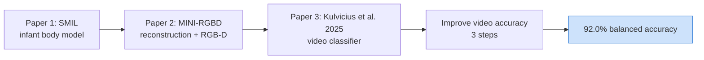

<p align="center">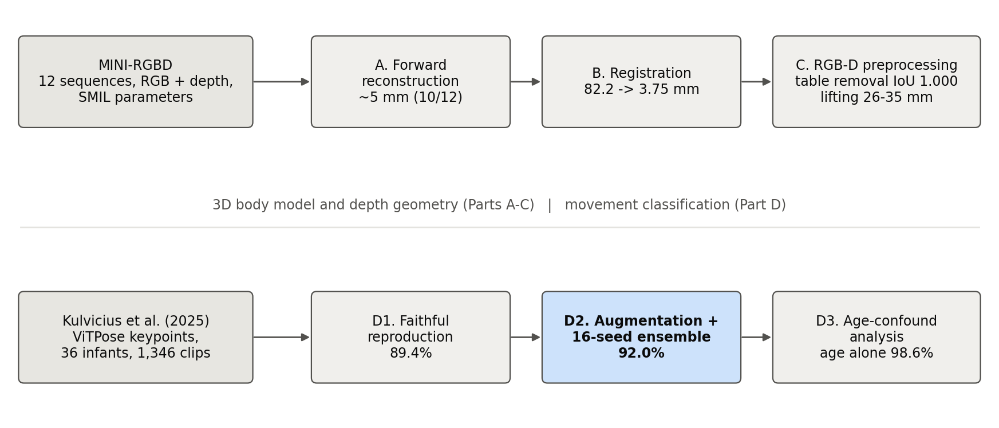</p>

---

## How the accuracy was improved: three steps

<p align="center">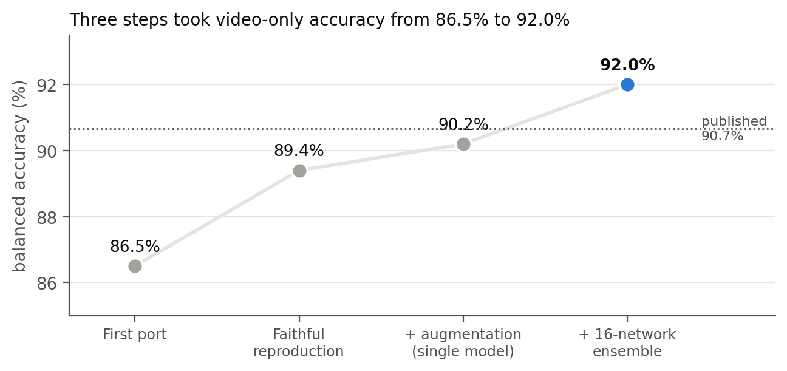</p>

### Step 1: Exact re-implementation (86.5% → 89.4%)

A line-by-line comparison with the authors' Keras code revealed three differences that the paper's architecture description doesn't show:

| Aspect | Typical PyTorch port | Original model |
|---|---|---|
| Kernel sharing | one kernel per channel (`groups=60`) | **one kernel shared by all 60 channels** |
| Layer order | Conv → BN → ReLU | **Conv → ReLU → BN → Dropout** |
| Defaults | BN momentum 0.1, ε 1e-5; Adam ε 1e-8 | **BN momentum 0.01, ε 1e-3; Adam ε 1e-7** |

<p align="center">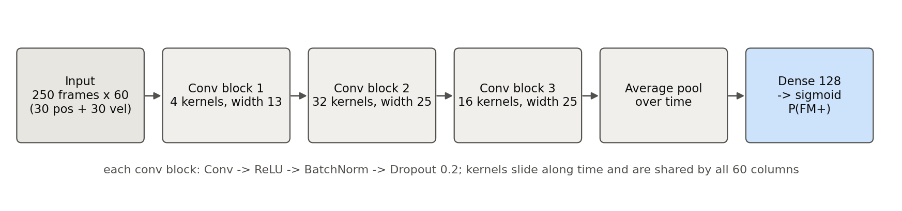</p>

### Step 2: Online skeleton augmentation

Every training clip is randomly **mirrored** (left and right joints swapped) and **rotated**:

$$x' = -x \ \text{(left} \leftrightarrow \text{right swapped)}, \qquad \begin{bmatrix}x'\\ y'\end{bmatrix} = R(\varphi)\begin{bmatrix}x\\ y\end{bmatrix}, \quad \varphi \sim \mathcal{N}(0, 8^\circ)$$

There is no scaling, on purpose: scaling would change the apparent movement speed, and body size is related to age.

### Step 3: Seed ensemble

Instead of keeping the single network with the lowest validation loss, the probabilities of 16 networks (8 plain + 8 augmented) are averaged:

$$\bar p(x) = \frac{1}{M}\sum_{m=1}^{M} \sigma\big(f_m(x)\big), \qquad \hat y = \mathbb{1}\left[\bar p(x) \ge 0.5\right]$$

---

## Results

<p align="center">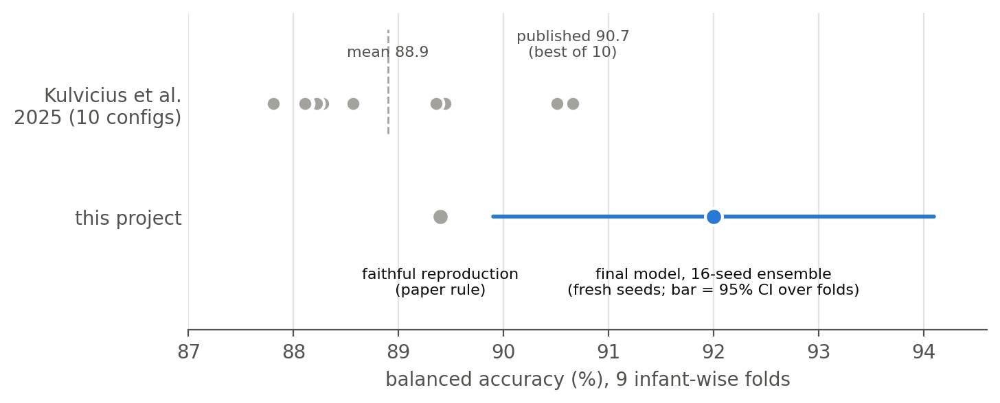</p>

| Model (video only, 9 infant-wise folds) | Balanced accuracy |
|---|---|
| Kulvicius et al. (2025), reported (best of 10 configurations) | 90.7% |
| Kulvicius et al. (2025), mean of 10 configurations | 88.9% |
| Faithful re-implementation (Step 1) | 89.4% |
| + augmentation, single network (Step 2) | 90.2% |
| **+ 16-network ensemble, fresh seeds (Step 3)** | **92.0%** |

<p align="center">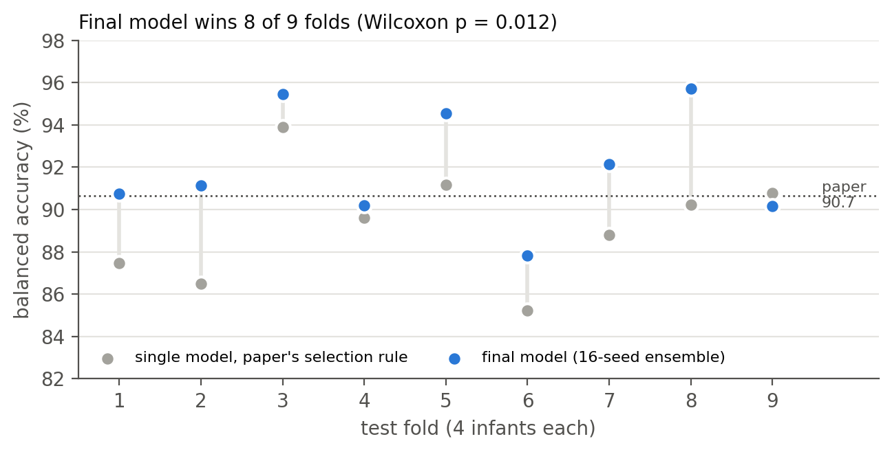</p>

| Paired comparison (Wilcoxon, 9 folds) | Gain | Folds won | p |
|---|---|---|---|
| Final ensemble vs original selection rule | +2.69 pts | 8 / 9 | **0.012** |
| 16 augmented vs 16 plain networks | +1.30 pts | 7 / 9 | **0.023** |

### Evaluation protocol

<p align="center">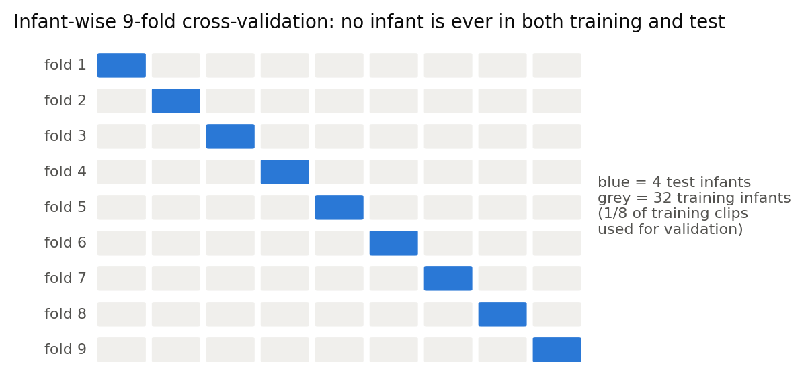</p>

- **Infant-wise 9-fold cross-validation:** no infant is ever in both training and test.
- **Rules fixed before experimenting:** a change is adopted only if the ensemble improves, then it is confirmed on new random seeds.
- **Every network's predictions are saved,** so all statistics can be regenerated without retraining.

### Other ideas tested

All of them were evaluated with the same rules, and none beat the final recipe:

<p align="center">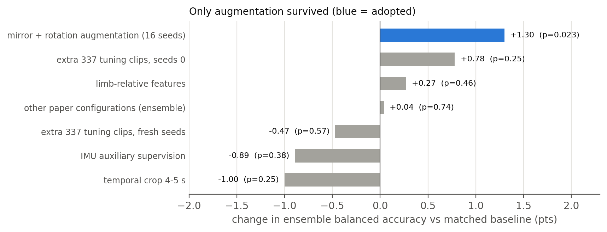</p>

### Recording age as a confounding variable

Fidgety movements appear at a specific age, so in this dataset the label is closely linked to recording age. Simple baselines show how much:

<p align="center">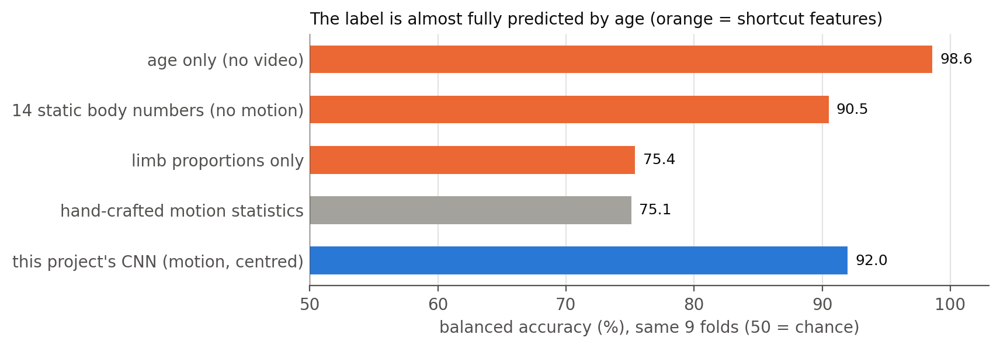</p>

The final model correctly classifies 12 of the 19 test clips whose label differs from the typical label for that age, which shows it uses movement information.

---

## 3D body model and RGB-D

| Experiment | Result |
|---|---|
| MINI-RGBD forward reconstruction (12 × 1,000 frames) | ~5 mm 3D joint error on 10/12 sequences |
| Registration recovery test (+0.3 rad, +4 cm perturbation) | 82.2 mm → **3.75 mm** |
| RANSAC table removal | plane within 0.01°, mask **IoU 1.000** |
| Lifting 2D joints with depth | 25.7–34.5 mm (depth sees skin, not joint centres) |

<p align="center">
  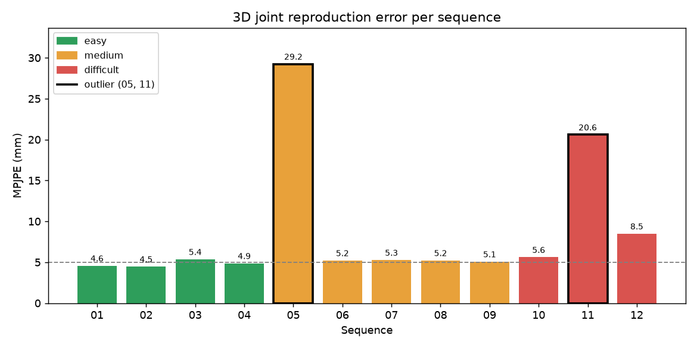
  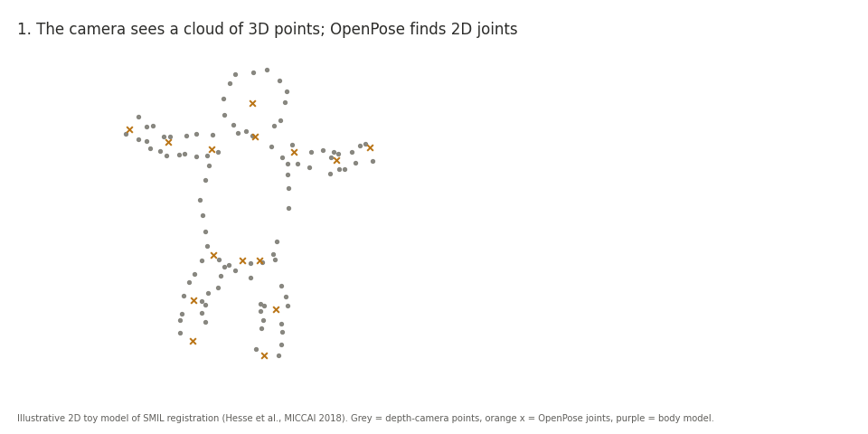
</p>

Registration minimises the distance between the depth point cloud and the body model:

$$L(\theta, \beta, T) = \frac{1}{N}\sum_i \min_{v} \lVert p_i - v \rVert^2 + \lambda_p \lVert\theta\rVert^2_{\Sigma} + \lambda_s \lVert\beta\rVert^2$$

---

## Repository structure

```
├── reproduction/      MINI-RGBD loading, SMIL forward reconstruction, depth/mask rendering, MPJPE / IoU / PCKh
├── registration/      registration energy and the controlled recovery test
├── classification/
│   ├── faithful.py      exact re-implementation, augmentation, parallel multi-network training
│   ├── analyse.py       selection rule, ensembles, Wilcoxon tests, age-discordant clips
│   ├── paper_numbers.py regenerates every reported number
│   ├── teacher.py       IMU teacher experiment
│   └── smil3d.py        SMIL fit to 2D keypoints
├── tools/             RANSAC table removal, joint lifting, diagnostics, figures
└── docs/figures/      figures used in this README
```

---

## Getting started

### 1. Install

```bash
git clone https://github.com/aryandhiman66-source/Computer-Vision-Based-3D-Infant-Pose-and-Motion-Analysis.git
cd Computer-Vision-Based-3D-Infant-Pose-and-Motion-Analysis
pip install -r requirements.txt
```

Install the CUDA build of PyTorch from [pytorch.org](https://pytorch.org) for GPU training.

### 2. Get the data (not included, licensed by their owners)

| Data | Source | Place in |
|---|---|---|
| SMIL infant body model | SMIL authors (Hesse et al., 2018) | `smil/` |
| MINI-RGBD dataset | Fraunhofer IOSB | `MINI-RGBD_web/` |
| Keypoint data and code | Kulvicius et al. (2025), links in the paper | `viddata/` |

### 3. Run

```bash
# 3D side: reconstruction metrics and RGB-D demo
python reproduction/evaluate_all.py
python tools/demo_lift_and_table.py 01 0

# Video classifier: 8 plain + 8 augmented networks per fold, then the analysis
python classification/faithful.py --runs 8 --seed 1 --tag paper_r8_s1
python classification/faithful.py --runs 8 --seed 1 --aug 8 --tag aug8_r8_s1
python classification/analyse.py paper_r8_s1 aug8_r8_s1
```

One experiment (9 folds × 8 networks) takes about 1.5 hours on an RTX 3050 laptop GPU.

---

## References

1. Hesse, N. et al. (2018). *Learning an infant body model from RGB-D data for accurate full body motion analysis.* MICCAI 2018.
2. Hesse, N. et al. (2018). *Computer vision for medical infant motion analysis: state of the art and RGB-D data set.* ECCV Workshops 2018.
3. Kulvicius, T. et al. (2025). *Deep learning empowered sensor fusion boosts infant movement classification.* Communications Medicine 5, 16.
4. Lakshminarayanan, B. et al. (2017). *Simple and scalable predictive uncertainty estimation using deep ensembles.* NeurIPS 2017.

## Acknowledgements

Thanks to my supervisor, Dr. Massoud Khodadadzadeh, and to the authors of SMIL, MINI-RGBD and Kulvicius et al. (2025) for making their models, data and code available. Parts of the code and documentation were developed with the help of an AI assistant (Claude, Anthropic).

> This is a research prototype on healthy infants. It is not a medical device and is not clinically validated.
